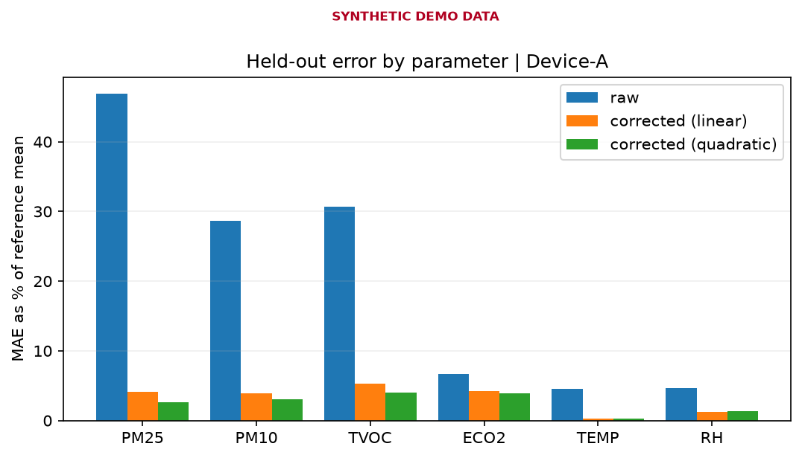
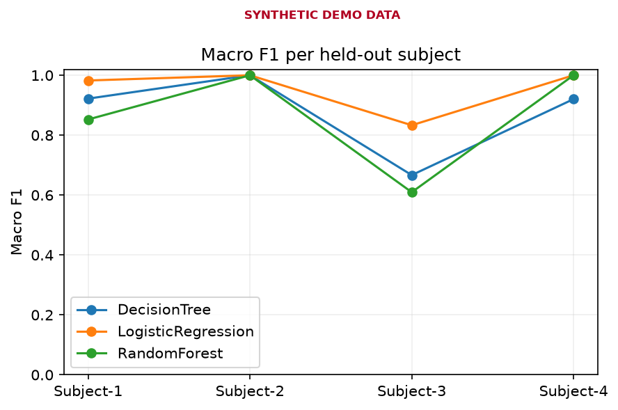
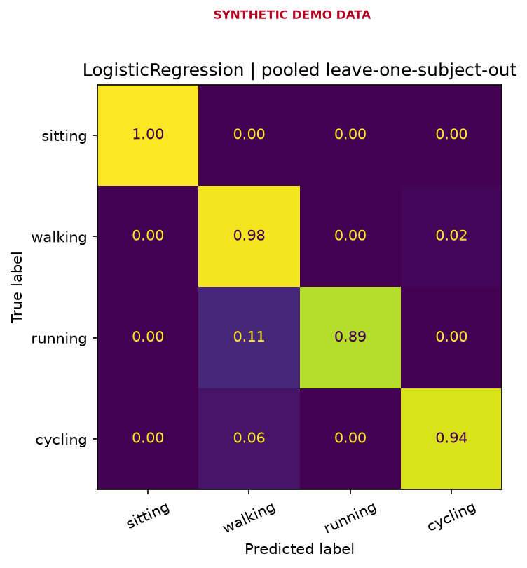
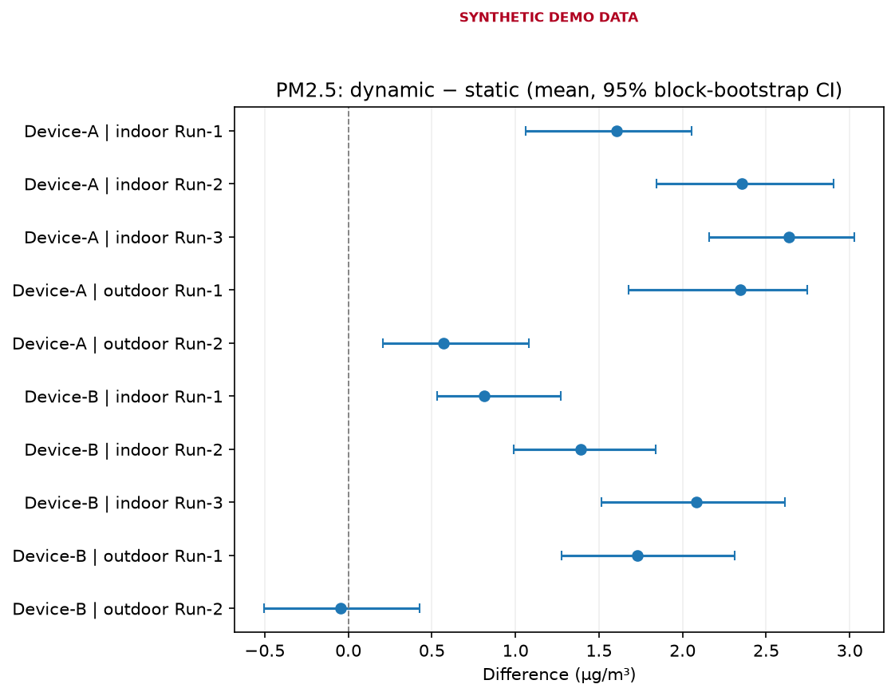
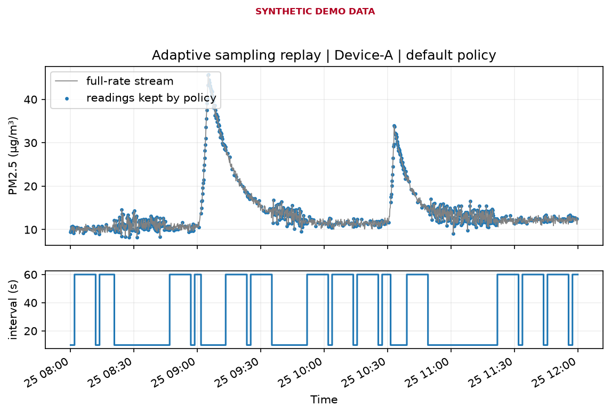

# Wearable Air-Quality Sensor Analytics

A reproducible Python workflow for analysing data from a **wearable low-cost air-quality monitor**: calibrating sensors against a reference instrument, checking how movement affects readings, recognising the wearer's activity from IMU signals, and evaluating an adaptive sampling policy.

> **All data in this repository is synthetic.** It is generated by [`scripts/generate_demo_data.py`](scripts/generate_demo_data.py) with a fixed random seed so that every step can be reproduced. The numbers and charts show what the workflow produces; they are not measurements and make no claim about any real device. Every figure is stamped *SYNTHETIC DEMO DATA*.

## Problems addressed

Low-cost wearable sensors are attractive for personal exposure monitoring, but their data raises four practical questions:

| # | Question | Approach | Key outputs |
|---|---|---|---|
| 1 | **Calibration:** how far are raw readings from a reference instrument, and does a correction model fix it? | Linear vs. quadratic correction per device and parameter, validated **leave-one-session-out** | MAE, RMSE, R², bias; held-out time series |
| 2 | **Movement:** do readings change when the wearer moves? | Within-run static vs. dynamic comparison with a **moving-block bootstrap** CI that respects autocorrelation | Difference ± 95% CI per run and device |
| 3 | **Activity recognition:** can the IMU tell sitting, walking, running and cycling apart? | 2 s sliding windows, 6 engineered features (incl. FFT dominant frequency), 3 classifiers, **leave-one-subject-out** | Accuracy / macro-F1 per held-out person, confusion matrix |
| 4 | **Adaptive sampling:** how many readings can be skipped when conditions are calm, and what is lost? | Replay a full-rate stream through a rule-based policy and reconstruct the signal | Reading reduction vs. reconstruction error trade-off |

## Highlights

**Calibration.** A quadratic correction helps where the sensor response is non-linear (particulate matter, and gas readings that saturate), while for temperature and humidity the simpler linear model is as good or better. Choosing model complexity per parameter from held-out error, rather than by default, is the point.

<p align="center"></p>

**Activity recognition.** Testing on a person the model has never seen exposes what a random split would hide: performance varies by subject, and the most flexible model (random forest) generalises worst to the most atypical person.

<p align="center"> </p>

**Movement.** Differences are reported with uncertainty and only within the same run. The demo data includes slow background drift, so the static-vs-dynamic difference partly reflects drift rather than movement, which is why the result is presented as descriptive, not causal.

<p align="center"></p>

**Adaptive sampling.** Raising the "calm" threshold skips more readings but increases reconstruction error and eventually misses part of a pollution peak.

<p align="center"></p>

## Methodological choices

- **No leakage across time or people.** Calibration is tested on whole unseen sessions and activity recognition on unseen subjects, because neighbouring rows of a time series and windows from the same person are nearly identical.
- **Uncertainty over point estimates.** Block bootstrap keeps consecutive readings together instead of treating them as independent samples.
- **Honest scope.** eCO₂ from metal-oxide sensors is an *estimate*, not a CO₂ measurement. Fewer readings is not the same as measured energy savings, which would need current and voltage measurements. Movement comparisons are descriptive.

## Run it

Requires Python 3.11+.

```bash
python -m venv .venv
# Windows: .venv\Scripts\activate    macOS/Linux: source .venv/bin/activate
pip install -r requirements.txt

python -m scripts.generate_demo_data     # (re)create the synthetic CSVs
python -m scripts.run_all                # all four analyses -> outputs/demo/
python -m pytest -q                      # unit tests
```

Each analysis can also be run on its own, e.g. `python -m scripts.har_analysis`. The notebook in `notebooks/` gives an interactive tour of the data.

## Repository structure

```text
├── data/
│   ├── demo/                  synthetic input CSVs (committed)
│   └── raw/                   your own data (git-ignored)
├── scripts/
│   ├── generate_demo_data.py  synthetic data generator
│   ├── calibration_analysis.py
│   ├── movement_analysis.py
│   ├── har_analysis.py
│   ├── sampling_analysis.py
│   ├── run_all.py             runs all four analyses
│   └── check_public_release.py  basic pre-publish screening
├── src/aq_analytics/          shared statistics and I/O helpers
├── notebooks/                 exploratory walkthrough
├── outputs/demo/              generated tables and figures
├── docs/DATA_DICTIONARY.md    input file formats
└── tests/                     unit tests (run by GitHub Actions)
```

## Using your own data

Prepare the four CSV files described in [`docs/DATA_DICTIONARY.md`](docs/DATA_DICTIONARY.md), put them in `data/raw/` (ignored by Git) and run:

```bash
python -m scripts.run_all --data-dir data/raw --out-dir outputs/local
```

Figures made from non-demo folders are stamped *LOCAL DATA — review before sharing*, and `outputs/local/` is also ignored by Git.

## Possible extensions

- Data-quality profiling: gaps, irregular timestamps, warm-up periods, outlier flags
- Humidity-aware PM correction (RH as a second predictor)
- Drift-adjusted movement comparison using a stationary co-located sensor
- Additional HAR features (spectral energy, jerk) and per-class error analysis

## Tech

Python · pandas · NumPy · scikit-learn · Matplotlib · pytest · GitHub Actions
